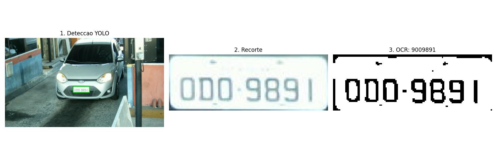
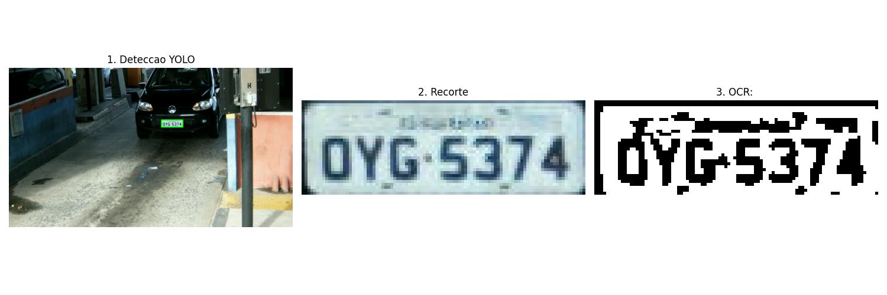

# Experimento 1

## 1. Pergunta e configuração

Pergunta: um limiar global de Otsu aplicado diretamente ao recorte da placa produz uma leitura melhor que o pré-processamento completo usado hoje no pipeline?

| Item | Configuração A: Otsu simples | Configuração B: pipeline completo |
|---|---|---|
| Tons de cinza | Sim | Sim |
| CLAHE (clipLimit 2,0; blocos 8x8) | Não | Sim |
| Filtro bilateral (d 11; sigmaColor 17; sigmaSpace 17) | Não | Sim |
| Binarização | Otsu global, `THRESH_BINARY_INV` | Adaptativo gaussiano, bloco 19, C 9, `THRESH_BINARY_INV` |
| Fechamento morfológico 2x2 | Não | Sim |
| Inversão final | Não (texto branco sobre fundo preto) | Sim (texto preto sobre fundo branco) |
| Correção de inclinação | Não | Não |

### O que mudou

Toda a cadeia de pré-processamento entre o recorte e o OCR. A configuração B corresponde ao `preprocessar_para_ocr` de `src/pre_processamento/filtros.py`, exceto pela correção de inclinação, que não foi incluída no experimento. Como várias etapas mudam juntas, o experimento compara dois métodos completos e não isola o efeito do tipo de limiar.

### O que permaneceu constante

- As mesmas 50 imagens nas duas configurações.
- O mesmo recorte: caixa do YOLOv8n ajustado (`Models/Deteccao_placa/best.pt`), confiança mínima 0,5, primeira detecção.
- O mesmo OCR: Tesseract `--psm 7` com lista de caracteres A-Z e 0-9 e a mesma limpeza por expressão regular.
- A mesma referência: campo `plate` da anotação original do RodoSol-ALPR.

## 2. Imagens e parâmetros

| Item | Valor |
|---|---|
| Quantidade | 50 imagens |
| Subconjunto | `cars-br` (carros, placa no padrão brasileiro antigo) |
| Seleção | Sorteio aleatório de 50 imagens de `cars-br` por `separar_amostras.py`, sem semente |
| Lista de IDs | `Data/splits/avaliacao_ids.txt` |
| Ajuste de parâmetros | Nenhum parâmetro foi ajustado com estas imagens; os valores da configuração B foram herdados do código do pipeline |

As imagens foram sorteadas do dataset original, sem verificar se pertenciam à divisão de treino do detector. Parte delas pode ter sido vista no treino do YOLO, o que pode favorecer a qualidade do recorte. Isso afeta igualmente as duas configurações e não altera a comparação entre elas.

## 3. Comando de execução

Na raiz do projeto:

```bash
docker build -t alpr-projeto .
```

```bash
docker run --rm -v "${PWD}/Data/results:/app/Data/results" alpr-projeto
```

O `src/main.py` executa o pipeline nas imagens de teste e, em seguida, `rodar_experimento(50)` de `src/experimentos/exp01.py`.

Saídas: `Data/results/exp01/resultados_exp01.csv`, com uma linha por imagem contendo a referência, as duas leituras e o acerto de cada configuração, e figuras de comparação em `docs/figuras/`.

O CSV usado neste documento está versionado em `Data/results/exp01/resultados_exp01.csv`, e o CSV do pipeline, em `Data/results/pipeline/resultados_pipeline.csv`.

## 4. Saídas intermediárias e finais

Para cada imagem, o experimento produz o recorte da placa, a placa binarizada em cada configuração e o texto lido em cada uma. As figuras de comparação mostram lado a lado o recorte com a referência, a saída do Otsu com a leitura e a saída do pipeline completo com a leitura.

A cada execução, o experimento grava em `docs/figuras/` figuras de comparação com sufixo `_sucesso_adaptativo.jpg` (só o pipeline completo acerta) ou `_falha_geral.jpg` (nenhuma configuração acerta). As figuras das seções 6 e 7 mostram as saídas do pipeline completo nos casos analisados, em três etapas: detecção do YOLO, recorte e placa preparada para o OCR.

## 5. Comparação com a referência e interpretação

Indicadores:

- Acerto exato: proporção de placas cuja leitura é idêntica ao campo `plate`.
- Acerto por caractere: média de 1 - CER, em que CER é a distância de edição (Levenshtein) entre leitura e referência dividida por 7, limitada a zero. Calculado a partir do CSV do experimento.

| Configuração | Acerto exato | Acerto por caractere | Leituras vazias | Leituras com 7 caracteres |
|---|---:|---:|---:|---:|
| A: Otsu simples | 20/50 (40%) | 74,3% | 5 | 33 |
| B: pipeline completo | 6/50 (12%) | 48,3% | 10 | 20 |

| Situação | Imagens |
|---|---:|
| As duas configurações acertam | 4 |
| Só o Otsu acerta | 16 |
| Só o pipeline completo acerta | 2 |
| Nenhuma acerta | 28 |

Interpretação:

- O Otsu simples superou o pipeline completo nos dois indicadores, com diferença de 28 pontos percentuais no acerto exato e 26 no acerto por caractere. O pipeline completo também gerou o dobro de leituras vazias.
- Na inspeção das saídas, o limiar adaptativo com janela de 19x19 pixels realça a moldura, os parafusos e a faixa superior da placa (inscrição da cidade), que é pequena em relação ao recorte. Esses elementos viram regiões que o Tesseract interpreta como caracteres ou que o impedem de identificar a linha de texto. O Otsu, por usar um único limiar para a placa inteira, separa melhor o fundo claro dos caracteres escuros nas placas do padrão antigo, que têm contraste alto e iluminação razoavelmente uniforme no recorte.
- Como as configurações diferem em várias etapas, o resultado não permite atribuir a diferença apenas ao tipo de limiar. A comparação isolada (mesma cadeia, só trocando o limiar) fica para a M3.
- Mesmo no melhor caso, 60% das placas não foram lidas corretamente. Dos 30 erros do Otsu, 10 são de um único caractere, a maioria confusões entre formas parecidas: Q lido como O em 5 placas (por exemplo `QRC6770` lido como `ORC6770`) e D lido como 0 em 2 (por exemplo `ODR7843` lido como `O0R7843`). No recorte, com cerca de 120x40 pixels, essas letras diferem por poucos pixels.

Decisão motivada pelo experimento: substituir ou revisar o limiar adaptativo no pipeline e avaliar o efeito isolado de cada etapa na M3 (ver plano no relatório).

## 6. Caso de sucesso

`img_001101`, placa `PPR1476`, lida corretamente pelo pipeline. O recorte do YOLO contém só a placa, o contraste entre caractere e fundo é alto e a binarização separa os sete caracteres sem que a moldura toque neles.


Figura 1. `img_001101`: detecção do YOLO, recorte e placa após o pré-processamento, com leitura `PPR1476`. A binarização mantém os sete caracteres separados entre si e da moldura; restam apenas manchas pequenas na faixa superior, que não interferem na leitura.

## 7. Caso de falha ou limitação

`img_000996`, placa `QRC5076`, vermelha com caracteres brancos (veículo de aluguel). Leitura do Otsu: `5076`; leitura do pipeline completo: `GRC076`. A polaridade dessa placa é inversa à das placas comuns: as duas configurações pressupõem caractere escuro sobre fundo claro, então os caracteres saem com a cor trocada para o OCR. O Q também foi lido como G.


Figura 2. `img_000996`: placa vermelha com caracteres brancos. Após a binarização, os caracteres ficam brancos sobre fundo preto, ao contrário das placas comuns, e a faixa superior e as bordas geram manchas. O OCR leu `GRC076` no lugar de `QRC5076`.

Outros casos de falha observados nas saídas do pipeline:

- `img_001679`: placa lida como `9009891`. A borda esquerda da placa virou um caractere extra e as letras O e D foram lidas como 0.



Figura 3. `img_001679`: a borda esquerda da placa aparece como uma barra vertical na imagem binarizada e foi lida como caractere; O e D foram lidos como 0, resultando em `9009891`.
- Placa `OYG5374`, uma das leituras vazias do pipeline: a faixa da cidade e a moldura geraram manchas grandes na binarização, e o Tesseract em modo de linha única não identificou o texto.



Figura 4. Placa `OYG5374`: a inscrição da cidade e a moldura viram manchas grandes, unidas à parte superior dos caracteres. O OCR não retornou texto.
