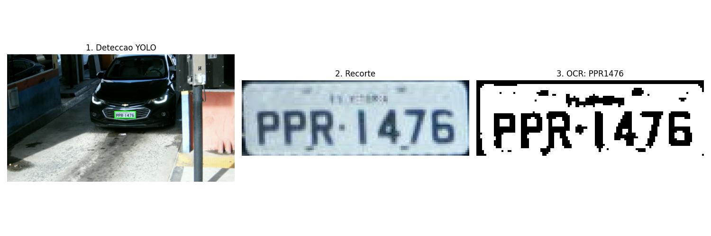
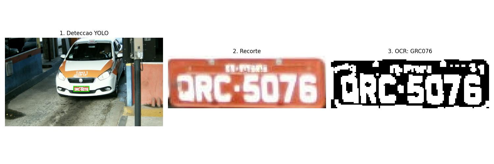

# Relatório Parcial M2

## Identificação

| Item | Informação |
|---|---|
| Projeto | Leitura automática de placas de veículos brasileiros (ALPR) |
| Integrantes | Gustavo Odilon da Costa, João Vitor Loch Martins, Kauan Rocha Dalfovo |
| Repositório | https://github.com/kauandal/Projeto_processamento_de_imagens |
| Commit/tag da entrega | Tag `m2-entrega` |
| Vídeo M2 | Não produzido na M2 (decisão D12 em [decisoes.md](decisoes.md)) |

## 1. Síntese do problema e objetivos atuais

O projeto trata do reconhecimento automático de placas brasileiras (ALPR) em imagens estáticas de câmeras de pedágio do conjunto RodoSol-ALPR. O objetivo é receber uma imagem de veículo, localizar a placa e produzir o texto nela escrito.

Na M2 o foco está em duas etapas: localizar a placa com um detector YOLOv8n ajustado ao dataset e preparar a região recortada com técnicas de processamento de imagens (realce, binarização, correção de inclinação e morfologia), com avaliação quantitativa da localização e comparação controlada de configurações de binarização e morfologia. A leitura com Tesseract é mantida como saída demonstrativa; a segmentação de caracteres e a avaliação completa da leitura ficam para a M3.

Objetivos, escopo e critérios de sucesso detalhados: [proposta.md](proposta.md).

## 2. Resposta ao feedback e evolução desde a M1

A revisão completa da devolutiva está em [revisao_m1_plano_m2.md](../revisao_m1_plano_m2.md). A tabela abaixo registra a ação efetivamente tomada para cada observação.

| Nº | Orientação recebida | Ação tomada | Arquivo/evidência |
|---:|---|---|---|
| 1 | Escopo do problema amplo | Escopo delimitado a imagens estáticas do RodoSol-ALPR, uma placa por imagem; vídeo e placas de motocicleta em duas linhas no OCR ficaram fora da M2 | [proposta.md, seção 4](proposta.md#4-escopo) |
| 2 | Sem amostra verificável do dataset | Origem, licença, obtenção, formato das anotações e preparação documentados; amostra de 100 imagens versionada em `Data/imagens_testes/`; IDs do experimento registrados em `Data/splits/avaliacao_ids.txt` | [dados.md](dados.md), `Data/imagens_testes/`, `Data/splits/` |
| 3 | Faltam métricas e critérios de sucesso | Definidos IoU contra os cantos anotados, taxa de localização correta (IoU >= 0,5) e acerto de leitura | [proposta.md, seção 6](proposta.md#6-critérios-de-sucesso), seção 6 deste relatório |
| 4 | Relação entre PDI, YOLO e OCR pouco clara | Pipeline descrito etapa por etapa, com entrada, saída e parâmetros de cada uma | Seções 4 e 5 deste relatório |
| 5 | Sem baseline executável | Pipeline executável de ponta a ponta com modelo ajustado e execução em Docker | `src/main.py`, `Dockerfile`, `Models/Deteccao_placa/best.pt` |
| 6 | Repositório com pouco conteúdo executável | Código de preparação de dados, treino, pré-processamento e OCR; dependências e comandos documentados | `src/`, `requirements.txt`, [README.md](../README.md) |
| 7 | Falta proposta técnica separada do README | Criado `docs/proposta.md` | [proposta.md](proposta.md) |
| 8 | Subtotal de 55,00/90 na devolutiva | Grupo apontou soma de 56,25/90 e solicitou esclarecimento | Resposta não registrada no repositório |
| 9 | Vídeo pendente com 10/10 pontos | Grupo solicitou confirmação da pontuação | Resposta não registrada no repositório |

Diferença em relação ao plano da M2: a revisão da M1 previa localizar a placa por segmentação clássica (limiarização, bordas e morfologia). O grupo manteve o detector YOLO, já previsto na proposta da M1, para a localização, e aplicou as técnicas de segmentação e morfologia na região recortada da placa. A justificativa está na decisão D1 de [decisoes.md](decisoes.md).

## 3. Dados e protocolo experimental

### 3.1 Origem e condições de uso

RodoSol-ALPR: 20.000 imagens de câmeras fixas de pedágio da ES-060 (ES), carros e motocicletas, placas nos padrões brasileiro e Mercosul. Acesso mediante termo de licença para uso acadêmico, assinado pelo grupo. O dataset completo não é versionado; uma amostra de 100 imagens está em `Data/imagens_testes/` para permitir a execução. Detalhes em [dados.md](dados.md).

### 3.2 Quantidade usada e critérios de seleção

Detector: 16.000 imagens em `train` e 4.000 em `test`, obtidas por divisão aleatória 80/20 dos quatro subconjuntos.

Experimento 1: 50 imagens de `cars-br` com anotação original, sorteadas por `separar_amostras.py` e versionadas em `Data/imagens_testes/dataset_original` (IDs em `Data/splits/avaliacao_ids.txt`). Pipeline: 50 imagens sorteadas de `test`, versionadas em `Data/imagens_testes/yolo`. O tamanho da amostra foi definido para permitir a execução completa no Docker e a inspeção individual das saídas dentro do prazo da M2.

### 3.3 Características e condições de aquisição

Imagens coloridas de 1280x720 pixels, de câmeras fixas frontais nas cabines de pedágio. Na anotação de `img_000002`, a placa ocupa cerca de 120x41 pixels, o que limita a resolução disponível para cada caractere. Nas imagens inspecionadas há variação de cor do veículo, de iluminação e de cor da placa, incluindo placas vermelhas de veículos de aluguel.

### 3.4 Casos típicos e difíceis

| ID da imagem | Subconjunto | Situação |
|---|---|---|
| `img_003207` | `cars-br` | Caso típico, lido corretamente (`PPW3952`) nas duas configurações |
| `img_000996` | `cars-br` | Placa vermelha com caracteres brancos, polaridade invertida |
| `img_001352` | `cars-br` | Confusão entre Q e O (`QRC6770` lido como `ORC6770`) |
| `img_000224` | `cars-br` | Leitura vazia nas duas configurações |

Placas de motocicleta e Mercosul não fazem parte da amostra do experimento 1.

### 3.5 Referência de avaliação

As referências são as anotações do próprio RodoSol-ALPR, produzidas pelos autores do dataset: os quatro cantos da placa, campo `corners` (referência de localização), e o texto da placa, campo `plate` (referência de leitura). Formato e exemplo em [dados.md, seção 5](dados.md#5-formato-das-anotações). O grupo não produziu anotações próprias e não revisou a qualidade das anotações; essa é uma limitação da avaliação.

### 3.6 Divisão entre ajuste e avaliação

Detector: divisão aleatória 80/20 em `train` e `test`, sem semente. O conjunto `test` (4.000 imagens) foi usado também como validação durante o treino, para a parada antecipada e para a escolha do `best.pt`. Não há, portanto, conjunto de teste independente para o detector: as métricas de localização obtidas nesse conjunto são tratadas neste relatório como métricas de validação, possivelmente otimistas. A correção (divisão oficial com validação separada) está no plano da M3.

Pré-processamento (método sem treino): nenhum parâmetro foi ajustado com as imagens de avaliação. Os parâmetros vieram do código do pipeline, por isso `Data/splits/ajuste_ids.txt` está vazio e toda a amostra de `Data/splits/avaliacao_ids.txt` é usada apenas para avaliação.

## 4. Pipeline implementado

### 4.1 Visão geral

```
imagem do veículo
  -> YOLOv8n ajustado (localização da placa)
  -> recorte da caixa delimitadora
  -> tons de cinza -> CLAHE -> filtro bilateral
  -> limiar adaptativo gaussiano (binarização)
  -> correção de inclinação
  -> fechamento morfológico 2x2 -> inversão
  -> Tesseract (linha única, A-Z e 0-9)
  -> texto da placa + figura em Data/results/
```

Ponto de entrada: `src/main.py`, executado diretamente ou pelo `Dockerfile`.

### 4.2 Etapas implementadas

| Etapa | Arquivo | Entrada | Saída | Parâmetros | Status |
|---|---|---|---|---|---|
| Preparação do dataset | `src/treinamento_modelos/preparar_dataset.py` | Imagens e anotações originais | Pastas `train`/`test` no formato YOLO | Divisão 80/20 | Implementado |
| Treino do detector | `src/treinamento_modelos/treinamento.py` | `data.yaml`, pesos `yolov8n.pt` | `best.pt` | 100 épocas, imgsz 640, batch 32, patience 10, GPU | Implementado |
| Localização | `src/main.py` | Imagem BGR | Caixa (xmin, ymin, xmax, ymax) | conf 0,5; primeira caixa | Implementado |
| Recorte | `src/main.py` | Imagem e caixa | Recorte da placa | | Implementado |
| Realce de contraste | `src/pre_processamento/filtros.py` (`aplicar_clahe`) | Placa em cinza | Placa realçada | clipLimit 2,0; tileGridSize 8x8 | Implementado |
| Suavização | `filtros.py` (`preprocessar_para_ocr`) | Placa realçada | Placa suavizada | Bilateral d 11, sigmaColor 17, sigmaSpace 17 | Implementado |
| Binarização | `filtros.py` | Placa suavizada | Máscara binária invertida | Adaptativo gaussiano, bloco 19, C 9 | Implementado |
| Correção de inclinação | `filtros.py` (`corrigir_inclinacao`) | Máscara binária | Máscara rotacionada | Ângulo de `minAreaRect` | Implementado, ver ressalva na seção 5.2 |
| Morfologia | `filtros.py` | Máscara alinhada | Máscara após fechamento | Elemento retangular 2x2 | Implementado |
| Leitura | `src/ocr/leitura.py` | Placa preparada | Texto A-Z/0-9 | Tesseract `--psm 7`, whitelist | Implementado (demonstrativo) |
| Saída visual | `src/main.py` | Etapas anteriores | `Data/results/resultado_final.jpg` | | Implementado |
| Experimento 1 | `src/experimentos/exp01.py` | Imagens com anotação original | `resultados_exp01.csv` e figuras | Otsu simples contra pipeline completo | Implementado |
| Execução em lote | `src/main.py` | 50 imagens de `test` | `resultados_pipeline.csv` e uma figura por imagem | | Implementado |
| Avaliação de localização (IoU) | `src/avaliacao/metricas.py` | Caixa prevista e cantos anotados | IoU por imagem | | Planejado para a M3 |

### 4.3 Etapas pendentes

| Etapa | Arquivo previsto | Função |
|---|---|---|
| Segmentação de caracteres | `src/regioes/componentes.py` | Rotular componentes conectados na placa binarizada |
| Descrição das regiões | `src/regioes/descritores.py` | Calcular atributos de forma e filtrar componentes que não são caracteres |
| Retificação por perspectiva | `src/retificacao/perspectiva.py` | Corrigir perspectiva a partir de 4 cantos |
| Pipeline integrado com avaliação | `src/pipeline.py` | Processar uma lista de IDs e gravar CSV de resultados |

## 5. Fundamentação das técnicas e parâmetros

### 5.1 Segmentação

Localização da placa (YOLOv8n). A função de separar a região da placa do restante da imagem, que na proposta da M1 seria feita por segmentação clássica, é realizada por um detector de objetos. O YOLOv8n é a menor variante da família YOLOv8; foi ajustado a partir de pesos pré-treinados no COCO, que não possui a classe placa, usando as caixas derivadas dos cantos anotados do RodoSol-ALPR. A saída é uma caixa delimitadora retangular, que equivale a uma segmentação da placa por região retangular. A variante n é a mais leve da família, o que reduz o custo de treino e de inferência. O limiar de confiança 0,5 descarta detecções fracas.

Realce com CLAHE. A equalização adaptativa de histograma com limite de contraste opera em blocos (8x8) e limita a amplificação (clipLimit 2,0), realçando caracteres em placas escuras ou com iluminação desigual sem amplificar excessivamente o ruído.

Filtro bilateral. Suaviza o ruído preservando bordas, pois pondera os vizinhos pela distância espacial e pela diferença de intensidade. Isso mantém a borda entre caractere e fundo, que é o que a binarização precisa separar.

Limiar adaptativo gaussiano. Cada pixel é comparado com a média ponderada gaussiana de uma vizinhança 19x19, menos a constante C = 9. Isso tolera variação de iluminação ao longo da placa, ao contrário de um limiar global. Com `THRESH_BINARY_INV`, os caracteres (escuros) viram primeiro plano branco. No experimento 1, o pipeline com esse limiar teve resultado inferior a um Otsu simples (seção 6).

### 5.2 Morfologia

Fechamento 2x2. Dilatação seguida de erosão com elemento retangular 2x2. Fecha pequenas falhas e interrupções nos traços dos caracteres após a binarização, sem alterar de forma relevante a espessura dos traços. A comparação com e sem essa etapa ficou para a M3.

Correção de inclinação. Estima o ângulo do menor retângulo rotacionado que contém todos os pixels brancos da máscara e rotaciona a imagem para alinhá-la. Ressalvas identificadas na revisão do código: as coordenadas vêm de `np.where` na ordem (linha, coluna), e a regra `angle < -45` corresponde à convenção de ângulo do OpenCV anterior à versão 4.5.1. O ângulo também pode ser dominado pela moldura da placa ou por ruído. A etapa não foi incluída no experimento 1, e sua verificação em placas inclinadas fica para a M3.

Inversão final. O Tesseract tem melhor desempenho com texto escuro sobre fundo claro, por isso a máscara é invertida antes da leitura.

### 5.3 Análise de regiões e componentes

Planejado para a M3. A placa binarizada será rotulada em componentes conectados (vizinhança 8). Cada componente candidato a caractere será filtrado pelos descritores da seção 5.4. A contagem esperada é de 7 caracteres por placa, o que permite medir o erro de contagem contra o texto anotado.

### 5.4 Representação e descrição

Planejado para a M3, aplicado a cada componente conectado:

| Atributo | Unidade | Forma de cálculo |
|---|---|---|
| Área | pixels | Número de pixels do componente |
| Altura relativa | adimensional | Altura da caixa do componente dividida pela altura da placa |
| Razão de aspecto | adimensional | Largura da caixa do componente dividida pela altura |
| Extensão (retangularidade) | adimensional | Área do componente dividida pela área da sua caixa delimitadora |
| Solidez | adimensional | Área do componente dividida pela área do seu fecho convexo |

Leitura com Tesseract. Modo `--psm 7` (uma linha de texto) e lista de caracteres permitidos A-Z e 0-9, seguidos de limpeza por expressão regular. Esse modo não atende placas de motocicleta, que têm duas linhas.

## 6. Experimentos e resultados

### 6.1 Experimento 1

Pergunta: um limiar global de Otsu aplicado diretamente ao recorte da placa produz leitura melhor que o pré-processamento completo do pipeline (CLAHE, filtro bilateral, limiar adaptativo, fechamento e inversão)?

As duas configurações foram aplicadas aos mesmos 50 recortes do YOLO, de imagens do subconjunto `cars-br` (IDs em `Data/splits/avaliacao_ids.txt`), com o mesmo OCR e a mesma referência (campo `plate`). Registro completo, comando de execução e casos em [experimentos/exp01.md](experimentos/exp01.md).

### 6.2 Experimento 2

Não realizado na M2. A comparação com e sem o fechamento morfológico, com o restante do pipeline constante, foi transferida para a M3, junto com a comparação isolada do tipo de limiar.

### 6.3 Tabela consolidada

| Experimento | Configuração | Imagens | Indicador | Resultado |
|---|---|---|---|---|
| 1 | A: Otsu simples | 50 (`cars-br`) | Acerto exato | 20/50 (40%) |
| 1 | A: Otsu simples | 50 (`cars-br`) | Acerto por caractere (1 - CER) | 74,3% |
| 1 | B: pipeline completo | 50 (`cars-br`) | Acerto exato | 6/50 (12%) |
| 1 | B: pipeline completo | 50 (`cars-br`) | Acerto por caractere (1 - CER) | 48,3% |
| Pipeline | YOLO + pipeline completo | 50 (`test`) | Imagens com placa detectada | 50/50 |
| Pipeline | YOLO + pipeline completo | 50 (`test`) | Leituras vazias | 30/50 |

As 50 imagens do pipeline não têm o texto de referência no CSV gerado, por isso só a detecção e as leituras vazias são contabilizadas. A detecção em todas as imagens não garante que o recorte esteja correto, pois o IoU não foi calculado; essa avaliação está planejada para a M3.

### 6.4 Análise

O Otsu simples superou o pipeline completo em 28 pontos percentuais no acerto exato e em 26 no acerto por caractere, e gerou metade das leituras vazias. Nas saídas do pipeline, o limiar adaptativo com janela 19x19 realça a moldura, os parafusos e a faixa superior da placa, que o Tesseract passa a tratar como texto. O resultado contraria a escolha atual do pipeline e motiva revisá-la na M3. Como as configurações diferem em várias etapas, o experimento não isola o efeito do tipo de limiar.

Mesmo no melhor caso, 60% das placas foram lidas com erro. Um terço dos erros do Otsu é de um único caractere, a maioria confusões entre Q e O ou entre D e 0, letras que diferem por poucos pixels em recortes de cerca de 120x40 pixels.

No pipeline, as leituras vazias se concentram nas imagens com ID a partir de 5000 (25 de 35, contra 5 de 15 abaixo de 5000). Hipótese, não verificada na M2: essas imagens pertencem aos subconjuntos Mercosul e de motocicletas, que o OCR em linha única não trata.

Caso de sucesso: `img_001101` (`PPR1476`), lida corretamente. Caso de falha: `img_000996` (`QRC5076`), placa vermelha com caracteres brancos, cuja polaridade inversa não é tratada por nenhuma das configurações. Detalhes em [experimentos/exp01.md](experimentos/exp01.md#6-caso-de-sucesso).



Figura 1. Caso de sucesso, `img_001101`. Da esquerda para a direita: detecção do YOLO, recorte da placa e saída do pré-processamento, lida como `PPR1476`. A binarização separa os sete caracteres da moldura, e o ruído restante na faixa superior é pequeno demais para interferir no OCR.



Figura 2. Caso de falha, `img_000996`. A placa vermelha tem caracteres brancos; após a binarização eles ficam brancos sobre fundo preto, polaridade inversa à das placas comuns, e a faixa superior gera manchas. O OCR leu `GRC076` no lugar de `QRC5076`.

Outras falhas analisadas, com figuras, estão em [experimentos/exp01.md](experimentos/exp01.md#7-caso-de-falha-ou-limitação).

## 7. Falhas, limitações e riscos

Riscos conhecidos antes dos experimentos estão listados em [proposta.md, seção 9](proposta.md#9-riscos). Falhas e limitações observadas:

- Polaridade invertida: placas vermelhas com caracteres brancos (`img_000996`) não são tratadas, pois as duas configurações pressupõem caractere escuro sobre fundo claro.
- Confusão entre caracteres de forma parecida: Q e O, D e 0. Em recortes de cerca de 120x40 pixels essas letras diferem por poucos pixels.
- Ruído da moldura e da faixa superior: no pipeline completo, o limiar adaptativo transforma moldura, parafusos e a inscrição da cidade em regiões que o OCR trata como texto ou que levam a leitura vazia.
- Leituras vazias: 30 de 50 no pipeline, concentradas nas imagens com ID a partir de 5000.
- Cobertura da avaliação: o experimento 1 usa apenas 50 imagens de `cars-br`; Mercosul e motocicletas não foram avaliados.
- Detector: o conjunto `test` foi usado também como validação no treino, e o IoU não foi calculado.
- Correção de inclinação: não verificada em placas inclinadas.

## 8. Plano de conclusão para a M3

Divisão de papéis mantida da M2: João no desenvolvimento do código, Gustavo nos testes e experimentos, Kauan na documentação.

| Tarefa | Responsável | Prazo | Evidência esperada |
|---|---|---|---|
| Adotar a divisão oficial do RodoSol-ALPR e retreinar o detector com validação separada | João | Entrega da M3 | `data.yaml`, IDs em `Data/splits/`, `results.csv` do treino |
| Revisar a binarização (Otsu ou adaptativo com janela maior) e tratar placas de polaridade invertida | João | Entrega da M3 | Código em `src/pre_processamento/` e nova execução do experimento 1 |
| Segmentar caracteres por componentes conectados e extrair descritores de forma | João | Entrega da M3 | Imagens rotuladas, tabela de descritores e erro de contagem contra 7 caracteres |
| Corrigir a correção de inclinação ou substituir por retificação de perspectiva | João | Entrega da M3 | Comparação antes/depois em placas inclinadas |
| Comparação isolada do tipo de limiar e experimento com e sem fechamento | Gustavo | Entrega da M3 | `docs/experimentos/exp02.md` e CSVs de resultado |
| Avaliar a localização (IoU) no conjunto de teste | Gustavo | Entrega da M3 | CSV com IoU por imagem, IoU médio e taxa de localização |
| Avaliar a leitura por subconjunto, incluindo Mercosul e motocicletas | Gustavo | Entrega da M3 | Acerto exato e por caractere por subconjunto |
| Relatório final, README e vídeo da M3 | Kauan | Entrega da M3 | `docs/relatorio_m3.md`, link do vídeo no README |

## 9. Contribuições dos integrantes

Registro detalhado em [contribuicoes.md](contribuicoes.md).

| Integrante | Contribuições | Evidências |
|---|---|---|
| João Vitor Loch Martins | Desenvolvimento do código principal: preparação do dataset, treino do detector, pré-processamento, OCR, pipeline, Docker e experimento 1; obtenção do dataset | `src/`, `Dockerfile`, `separar_amostras.py`, `Models/Deteccao_placa/best.pt`; commits de 26 e 27/10/2026 |
| Gustavo Odilon da Costa | Testes do pipeline e do experimento 1: execução, conferência das leituras com a referência e análise dos casos de sucesso e de falha | `Data/results/`, `docs/experimentos/exp01.md` |
| Kauan Rocha Dalfovo | Documentação: revisão da M1, estrutura do repositório, proposta, dados, relatório, decisões, roteiro e README | `docs/`, `README.md`, `revisao_m1_plano_m2.md`; commits de 15/09 e 27/10/2026 |

## 10. Referências

1. LAROCA, R. et al. On the Cross-dataset Generalization in License Plate Recognition. In: VISAPP, 2022. (Artigo de apresentação do RodoSol-ALPR.)
2. RodoSol-ALPR Dataset. https://github.com/raysonlaroca/rodosol-alpr-dataset
3. JOCHER, G.; CHAURASIA, A.; QIU, J. Ultralytics YOLOv8. 2023. https://github.com/ultralytics/ultralytics (licença AGPL-3.0)
4. SMITH, R. An Overview of the Tesseract OCR Engine. In: ICDAR, 2007.
5. ZUIDERVELD, K. Contrast Limited Adaptive Histogram Equalization. In: Graphics Gems IV, 1994.
6. TOMASI, C.; MANDUCHI, R. Bilateral Filtering for Gray and Color Images. In: ICCV, 1998.
7. GONZALEZ, R. C.; WOODS, R. E. Digital Image Processing. 4. ed. Pearson, 2018.
8. OpenCV Documentation. https://docs.opencv.org/

## 11. Declaração de uso de IA generativa

Ver [uso_ia.md](uso_ia.md).
